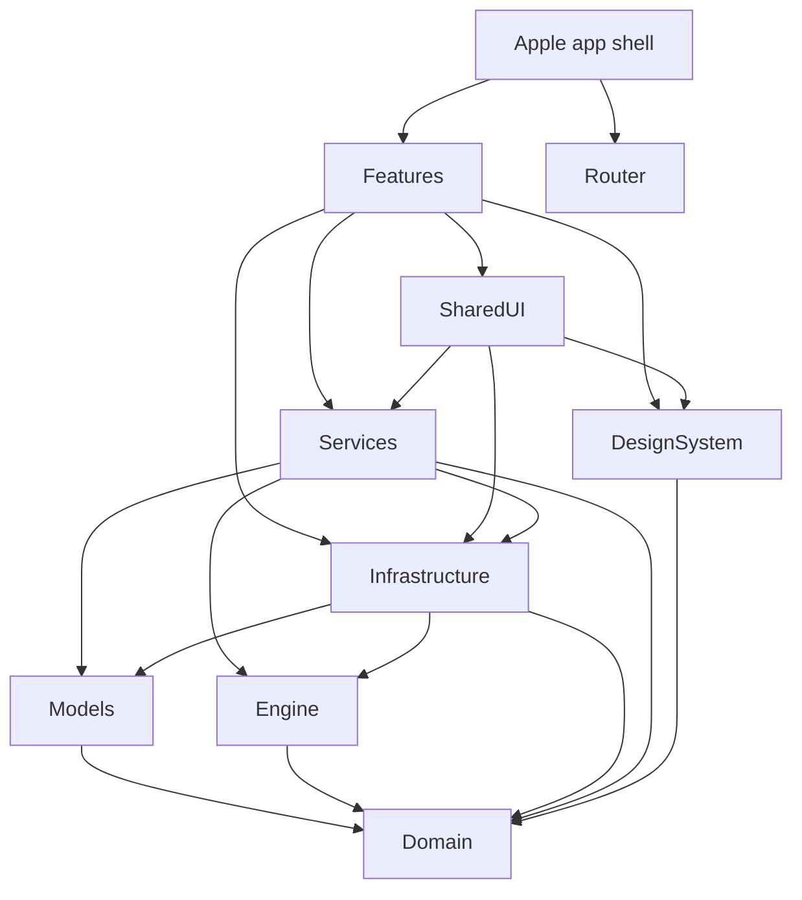

# Ride On architecture

Ride On has one adaptive Apple app for iPhone, iPad and Mac, an iOS/macOS widget
extension, a Cloudflare API, a web app and a Chrome/Safari extension. The Apple
app's UI and the deployed API protocol are preserved by this migration.

## Repository and dependency graph

```text
apple/
  app/                  shared iOS/macOS XcodeGen shell, widgets, assets and tests
  Packages/
    Domain/             Foundation value types and service protocols
    Models/             existing SwiftData entities and domain mappings
    Engine/             pure scoring, GPX/FIT parsing and geometry
    Infrastructure/     Networking, Persistence and PlatformServices products
    Services/           application coordination, use cases and fixture composition
    DesignSystem/       SwiftUI colour, motion and presentation tokens
    Router/             tab identities
    Features/           SharedUI, RideUI, RoutesUI, PreferencesUI, OnboardingUI
  scripts/              Apple verification and device delivery
api/
  src/app.ts            HTTP composition; injectable createApp test seam
  src/index.ts          Worker fetch, scheduled and queue entrypoints
  src/schemas/          canonical library/profile request and response shapes
  src/http/             route descriptors and registration
  src/<capability>/     existing account, route, recommendation and tracking services
  contracts/            generated OpenAPI, TypeScript declarations and JSON fixtures
  docs/protocol.md      wire semantics and explicit contract coverage
web/, extension/, landing/, maps/ remain independent consumers
```

`apple/app` intentionally holds the existing **multiplatform** shell. Duplicating
it into iOS and Mac projects would change composition and release behaviour for
no current product need. Add a separate `apple/watchos` or `apple/macos` shell
when its interface needs independent composition; no Watch support is claimed.



Targets list their actual direct product dependencies. `RideUI` no longer
imports `RoutesUI`: the shell supplies its Track a Route sheet factory to both
the fixture and live rides entrypoints. Route-detail navigation is also composed
by the shell. SharedUI owns map rendering and snapshots, while Services has no
SwiftUI dependency. Widgets link Domain and DesignSystem, avoiding MapLibre,
networking and SwiftData.

Infrastructure exposes three products:

- **Networking:** HTTPTransport with an injected endpoint/loader, RideOnAPI's
  existing session facade, keychain storage, Strava transport and wire adapters.
  It has no SwiftUI, SwiftData or app-bundle discovery. The existing static API
  facade deliberately preserves account/session behaviour; new transports can
  be composed with explicit configuration.
- **Persistence:** SwiftData container configuration, local preferences and
  account-scoped atomic board-cache byte storage. Fixture/reset flags are passed
  in by the app shell; the production container remains CloudKit backed.
- **PlatformServices:** location, ETA, WeatherKit, HealthKit and native OAuth.
  These are iOS/macOS adapters, with existing platform availability guards.

Services owns board loading/coalescing, snapshot validity, tracking, settings,
imports and account isolation. The application keeps the versioned board
snapshot envelope and maps server payloads into Domain presentation values;
Persistence stores its bytes without redefining the format. Existing tolerant
Codable adapters still accept historical optional fields.

## Compatibility baseline

The pre-migration source is `2cca1ce` (PR #320). The baseline iOS simulator build,
17 Models tests, API unit tests and 300 real Workers/D1 integration tests passed.
The local API initially needed its locked dependencies installed.

The three SwiftData entities remain in their original **Models** module with
unchanged stored properties. Their persisted values remain primitive, packed
Data or JSON. Moving the separate pure value types into Domain does not rename
the entities. `apple/scripts/check-legacy-store.sh` builds the baseline Models
package from git, writes synthetic route/log/place records to SQLite, and opens
the same file with the new code. It checks identifiers, dates, coordinates,
elevation nulls, surface JSON, overrides, provenance and pending classification.
It never touches personal app data or CloudKit.

Preserved identities and formats include:

- `com.danbarclay.rideon`, its widget bundle, signing team, entitlements,
  `iCloud.com.danbarclay.rideon`, `group.com.danbarclay.rideon`, URL schemes and
  associated domains
- SwiftData's default store configuration and CloudKit ownership; this migration
  does not replace the existing local/CloudKit store with server sync
- Keychain account keys, login identity and account binding, token rotation,
  profile-request coalescing and rejection of late responses after sign-out
- UserDefaults keys, onboarding flags, widget Codable snapshots and
  `Caches/RideBoards/<sha256(account)>.json`, schema version 1, atomic writes and
  iOS file protection
- API URLs, paths, status/error envelopes, defaults, optimistic versions,
  idempotency keys, D1 migrations, all Worker/R2/KV/D1/Queue/service identities

The old `/classify` and Strava token-proxy clients remain legacy code; their
server endpoints had already been removed before this task. This structural
migration does not revive them or redesign the current Stitch connection.

## Contracts and consumers

Run `cd api && bun run contracts:generate`; use `bun run contracts:check` to
verify committed artifacts and the Swift fixture copies. See
[API protocol](../api/docs/protocol.md) for the exact generated coverage.

OpenAPI is generated from descriptors that register the actual Hono handlers.
Existing bounded parsing stays in those handlers, preserving media/UTF-8
handling, coercion, unknown-field rejection and auth/error precedence. New
routes can use OpenAPIHono's automatic validation when compatible with their
parser requirements. Schemas own TypeScript shapes via `z.infer`; browser
consumers import generated declarations **type-only**, never server code.

The extension consumes canonical surface and selection types; the web app uses
the selection type as a view projection. Swift's Networking adapters decode the
same API-owned selection/error fixtures used by Zod and JSON Schema checks.
Generation checks the copies in its test bundle. Other existing client adapters
remain intentionally tolerant of older responses and cached data.

## Local verification and delivery

```sh
apple/scripts/check-legacy-store.sh
swift test --package-path apple/Packages/Models
swift test --package-path apple/Packages/Engine
swift test --package-path apple/Packages/Infrastructure
swift test --package-path apple/Packages/Services
swift test --package-path apple/Packages/Features
xcodegen generate --spec apple/app/project.yml
xcodebuild -project apple/app/RideOn.xcodeproj -scheme RideOn \
  -destination 'generic/platform=iOS Simulator' CODE_SIGNING_ALLOWED=NO build
xcodebuild -project apple/app/RideOn.xcodeproj -scheme RideOn \
  -destination 'platform=macOS' CODE_SIGNING_ALLOWED=NO build
apple/scripts/run-on-device.sh --preflight
```

Run the shared test plan on an available iOS 27.1 simulator for app integration
and fixture-world UI tests. Live-network snapshot/classify checks remain opt-in.
For API checks use `bun run check` and `bun run build:check` inside `api/`.
Check extension Chrome E2E and Safari output, web checks/build, and map/landing
builds after touching their shared asset paths. Existing CI policy is retained;
no new remote native suite was added.

The existing device entrypoint is now `apple/scripts/run-on-device.sh`; its
`--preflight` mode resolves the project and device build settings without
signing or installing. API deploy workflows now use `api/`, retaining resource
names and the main-only release guard. A successful unsigned build or preflight
is not proof of physical-device, production CloudKit or TestFlight delivery.
No production deployment or data migration is part of this change.

## Adding a feature

Add domain values/protocols only when shared business rules need them. Add
network/persistence adapters to their focused Infrastructure product and put
observable shared coordination in Services. Add a target/product inside
Features with only its direct dependencies. Its public entrypoint accepts the
needed state/actions; the shell connects sibling-feature navigation. Put UI
resources in the owning target and access them through `Bundle.module`.

Add API schemas below services, a route descriptor beside its handler, protocol
semantics and representative fixtures. Extend the existing integration harness
contract assertions, regenerate the artifacts, and update each affected client.
Keep wire evolution independent of stored schema evolution. Compile every
platform you claim; declaring it in Package.swift is insufficient.
