# Ride On iOS redesign: screens and build checklist

The approved Claude Design canvas, written down screen by screen so the SwiftUI rebuild has one
place to check against. The canvas is the visual source of truth:
https://claude.ai/artifact/9rYWTxdZVkx21dpJRrue7T (version 36). The rules behind it (materials,
colour, type, motion, accessibility) live in [`DESIGN-SYSTEM.md`](../../DESIGN-SYSTEM.md); this
doc is the *what*, that one is the *how*.

**Approach.** The UI is rebuilt from scratch. Nothing from the previous Ride/You/SharedUI views
is adapted. Screens are built against sample data shaped like the canvas (see
[Sample data](#sample-data)), then wired to the existing API
(https://api.ride-on.cc, already powering the Safari client) in a later pass.

This doc is updated with every PR that lands a piece of the redesign: tick the item, note the PR.

## Status

| # | Piece | Status | PR |
|---|---|---|---|
| 0 | This doc and reference images | ✅ Done | #154 |
| 1 | Foundation: green accent, Rides/Routes/Preferences tabs, `RideBoard` sample data | ✅ Done | #155 |
| 2 | Rides screen and Track sheet | ✅ Done; tracking wired to API v0.28.0 ([contract](../ride-tracking-api.md)); notifications wait on the API | #155, #176, #185 |
| 3 | Ride detail | ✅ Done; wind direction and score change wired to API v0.25.0 ([contract](ride-detail-api-requests.md)) | #157, #164, #172 |
| 4 | Ride Window sheet and Window passed | 🟡 Sheet done; Window passed remaining | #162 |
| 5 | Preferences, Ideal Temperature, Comfortable Wind | ✅ Done, live, on API v0.25.0 (points lost, crosswind levels, sign-in methods, monthly limits, separate units); Strava connection/history implemented, coordinated rollout pending ([contract](../strava.md)) | #167, #172 |
| 6 | Widgets and Lock Screen | ⬜ | |
| 7 | Remove the old UI (RideView, RideCard, BestDayBadge, ScoreRing…) | 🟡 YouUI gone (PreferencesUI replaced it) | #167 |
| 8 | Wire to the API | 🟡 Rides, Ride detail, Ride Window, Preferences and Routes live; route imports to come | #159, #162, #167, #172, #195 |
| 9 | Routes tab: map, floating panel, shortlist, library, history | ✅ Done, on the API | #194, #195 |

Not in scope yet: Onboarding (not redesigned; it keeps working as it is).

API v0.29.0 adds [route outlines and wind sections](../extension-api-brief-v7.md)
for the wind dropdown, without changing scoring. Short headwind/crosswind sections
remain visible; clients may omit tiny labels but must preserve the section colours.
Historical plans can omit `windStretches`; newly generated plans retain them.

API v0.26.0 provides separate opt-in cold sensitivity and seasonal temperature
tolerance; [contract and calibration](../seasonal-temperature.md). Client controls
are still pending. Preserve these choices on partial edits and keep the existing
user-chosen monthly minimum standards separate.

API v0.27.0 adds the opt-in [tailwind opportunity preference](../tailwind-opportunity.md).
Client controls and the separate reason are pending. Preserve API ranking order;
continue rendering `score` as Conditions, never the new 0–105 ordering value
`recommendationPriority`. Use `tailwindOpportunity.reason` to explain the extra
priority, and preserve the boolean on unrelated preference edits.

## Where the code goes

| What | Where |
|---|---|
| Presentation value types + `.sample` | `app/Packages/Models/Sources/Models/RideBoard.swift` |
| The nine components (DESIGN-SYSTEM.md §6) | `app/Packages/Features/Sources/SharedUI/` |
| Rides, Ride detail, Window sheet, Window passed | `app/Packages/Features/Sources/RideUI/` |
| Preferences, Ideal Temperature, Comfortable Wind | `app/Packages/Features/Sources/PreferencesUI/` (replaced YouUI; About moved here) |
| Routes: map, panel, cards, rows | `app/Packages/Features/Sources/RoutesUI/`; data in `app/Packages/Models/Sources/Models/RouteLibrary.swift` (`RouteLibrary.sample`, `SampleRoutes`) |
| Saved settings (`RiderSettings`, `RiderSettingsStore`) | `app/Packages/Services/Sources/Services/RiderSettings.swift` |
| Tabs | `app/Packages/Router/Sources/Router/AppTab.swift`: `rides`, `routes`, `preferences` |
| Accent | `app/App/Assets.xcassets/AccentColor`: `#248A3D` light, `#30D158` dark |
| Widgets | New widget extension target in `app/project.yml` |

---

## 1. Rides (tab)

| Light | Dark |
|---|---|
| 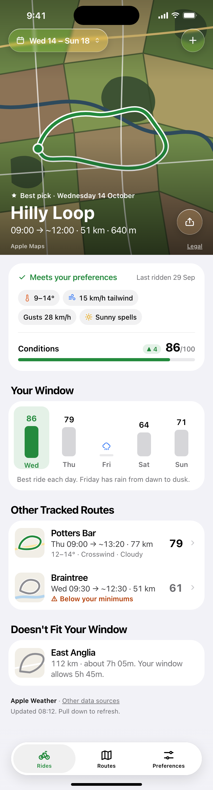 | 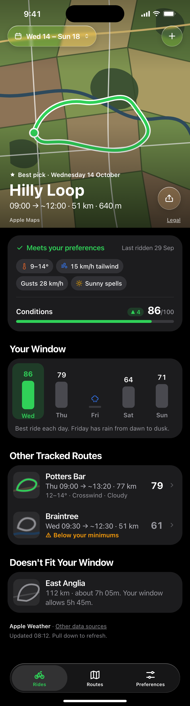 |

Top to bottom:

1. **Hero** (`RideHero`, at least 480pt, taller when large text needs it; edge to edge under the
   status bar). A non-interactive satellite `Map` of the best pick with the route in accent on a
   white casing and a start marker; an eased black scrim (at least 340pt, 0 → 80% with no
   visible top edge) sized to the title block. The hero follows canvas board
   `HeroD.dc.html` ("3b"), which supersedes the hero in the screenshots above.
   - "★ Best pick" pill (a small `star.fill`, `.caption2` bold at `.small` scale, 4pt before the
     label, as on canvas board `HeroA`; `.footnote` semibold, white on `pickPill` green, 7pt
     leading and 9pt trailing; "★ Best that day" for
     another day's best; no pill in detail when it's neither)
   - "Hilly Loop" (`.largeTitle` bold, white)
   - ↔ 51 km · ⛰ 640 m climb (`.subheadline`, white 88%, monospaced digits, wraps at large
     text). Soft text shadow on the whole block. No date or times: they lead the card.
   - Track bell: 48pt clear-glass circle, bottom right, `bell`. Tap opens the
     [Track sheet](#track-sheet); while the ride is tracked it's `bell.fill` on gold-tinted glass
     (`.committed`). Label "Track Hilly Loop on Wednesday 14 October" ("Tracking …" while on),
     Selected trait while on.
   - The `Map`'s own "Maps" and "Legal" attribution, bottom leading.
   - Tap anywhere else on the hero: zoom to Ride detail.
2. **Conditions card** (solid card, 26pt radius).
   - "Wednesday 14 October" (`.subheadline` semibold), then a flight-board row: "09:00" over
     "Leave" · dashed line, accent `bicycle`, dashed line over "About 3h 00m" · "~12:00" over
     "Back" (`.title` bold over `.footnote` secondary). One VoiceOver sentence: "Wednesday 14
     October. Leave 09:00, about 3 hours, back about 12:00." At large text it falls back to
     "09:00 → ~12:00" over the duration. Hairline divider.
   - "✓ Meets your preferences" (accent, `.subheadline` semibold) · "Last ridden 29 Sep" trailing
     (`.footnote`, secondary). Stacks at large text sizes.
   - `ConditionChip`s: 🌡 9–14° · 15 km/h tailwind · Gusts 28 km/h · ☀ Sunny spells.
   - Hairline divider, then "Conditions" (`.subheadline` semibold) · "▲ 4" badge (accent soft
     fill) · "86/100" (`.title2` bold over `.footnote`).
   - Progress bar, 6pt, accent fill at 86%.
3. **"Your Window"** section header, then `DayStrip` in a card: one column per day in the window.
   Wed 86 (selected: accent bar, soft accent background), Thu 79, Fri rain symbol with a short grey
   stub (no ride, not tappable), Sat 64, Sun 71. Bar height tracks score.
   Footnote inside the card: "Best ride each day. Friday has rain from dawn to dusk."
   Tapping a day swaps the hero to that day's best ride.
4. **"Other Tracked Routes"** card of rows: route thumbnail (56pt, 12pt radius: the route's outline
   on a plain land fill, not a map, so no labels or Legal link at that size), name (`.headline`),
   "Thu 09:00 → ~13:20 · 77 km", conditions line or "⚠ Below your minimums" in warn colour, score
   (`.title3` bold, monospaced) and chevron. At accessibility sizes the text drops below the
   thumbnail.
   - Potters Bar: Thu 09:00 → ~13:20 · 77 km · "12–14° · Crosswind · Cloudy" · 79
   - Braintree: Wed 09:30 → ~12:30 · 51 km · "Below your minimums" · 61
5. **"Doesn't Fit Your Window"** card: East Anglia, "112 km · about 7h 05m. Your window allows
   5h 45m." No score.
6. **Footer**: "Apple Weather" · "Other data sources" link; "Updated 08:12. Pull down to refresh."

Chrome:
- Toolbar leading: window capsule "📅 Wed 14 – Sun 18 ⌃⌄" opening the Ride Window sheet.
  Trailing: "+" circle ("Track a route"). Both clear glass over the hero with a ~35% top dim,
  regular glass once content scrolls under them (about 340–400pt).
- Tab bar: Rides (selected) · Routes · Preferences. Minimises on scroll down.
- Pull to refresh. The hero map stretches to fill the pull, so no background shows above it.

Build:
- [x] `RideHero`: `Map` with interactions off + route polyline (`SharedUI/RouteMap.swift`)
- [x] Toolbar capsule + "+": system glass handles clear → regular on scroll. Both are no-ops
      until the Ride Window sheet (4) and route tracking exist
- [x] Conditions card with `ConditionChip`s and score bar
- [x] `DayStrip`: tapping a day swaps the hero to that day's best
- [x] Other Tracked Routes rows (open Ride detail), Doesn't Fit rows
- [x] Footer attribution
- [x] Hero map stretches on overscroll instead of showing the background (#178)
- [x] Hero route line keeps its colour after a sheet closes, rather than staying dimmed grey (#185)
- [x] Zoom transition source on the hero and each route row
- [x] Light/dark and Dynamic Type through `accessibility5` checked on the simulator
- [x] Hero 3b: eased scrim, pick pill, icon stats, track star (gold glass when on) and the
      card's date/Leave–Back header
- [x] Track sheet (#176)
- [x] Persistent tracking API v0.28.0: one active plan, accepted recommendation references,
      immutable baseline, explicit refresh, replacement, retained history and erasure ([contract](../ride-tracking-api.md))
- [x] Track sheet on the API (#185): `RideTracker` tracks the window pick's `recommendationRef`
      with the current tracking version and an idempotency key, refreshes when the Tracking sheet
      opens, says what changed (or why the check failed), and confirms a replacement
- [x] Star in the pick pill; the track star is a bell, so the star means best pick and the bell
      means tracking
- [ ] Background monitoring and notifications (follow-up API PR); the notification copy and
      permission request below switch on when `capabilities.notifications` is true
- [ ] A tracked ride that isn't the hero has no bell, so the rider can only see it by picking its
      day. Show it somewhere on Rides
- [ ] Reduce Transparency

### Track sheet

Canvas boards `TrackFlow`, `TrackSheet`, `TrackSheetTracking`, `TrackSheetDark`. The hero's bell
opens it. Tracking saves the ride's forecast, and each later check compares the latest forecast
with it until the rider leaves. One ride is tracked at a time.

A content-height detent, so iOS 26 floats it inset as Liquid Glass over the dimmed Rides screen.
It slides up on the system curve with no bounce (a cross-fade with Reduce Motion). Its mode is
fixed when it opens.

API v0.28.0 checks only when asked and doesn't notify (`capabilities.notifications: false`), so
the sheet doesn't promise alerts. The canvas's notification copy is kept for when it does, and is
marked *(notifications)* below.

1. Grabber; Close (glass circle, `xmark`, `role: .close`) top leading.
2. Medal: 64pt gold (`.committed`) circle with a white `star.fill`. *(notifications)* A 28pt
   `bell.fill` badge bottom right.
3. **Track mode** (not tracked):
   - "Track This Ride" (`.title2` bold, centred), then "We'll save this forecast and compare it
     with the latest each time you check back." *(notifications)* "We'll keep checking the
     forecast and notify you if anything changes before you leave."
   - Another ride is tracked: a card with `star.slash` (gold), "Replaces Your Tracked Ride" and
     "Ridge Run · Sat 18 Oct, 09:00". Start Tracking replaces it in one request.
   - Ride card: 48pt route thumbnail, "Hilly Loop", "Wed 14 Oct · 09:00 → ~12:00", a 40pt
     `ScoreGauge` showing 86.
   - **"We'll Check If"** *(notifications: "Notify Me If")*: "Rain moves in" (`cloud.rain`, rain
     blue); "Gusts pass your 45 km/h limit" (`wind`, cyan); "It drops below your 4° minimum"
     (`thermometer.low`, indigo); "A better time or day opens up" (`clock`, accent). A limit the
     rider hasn't set has no row.
   - Footnote: "Checked each time you open this ride, until you leave." *(notifications)* "Plus
     the final forecast the evening before." plus " iOS will ask to allow notifications." until
     they've been asked.
   - "Start Tracking" (`.glassProminent` capsule, no icon), then "Not Now" (plain accent).
4. **Tracking mode**:
   - "Tracking This Ride", then what the latest check found, in sentences:
     - Nothing new: "Forecast checked just now. Nothing has changed since you started tracking."
     - Changes, most important first: "Gusts now reach 52 km/h, over your 45 km/h limit." "Rain
       is now forecast." "Ridge Run at 09:30 now looks better." "Its score has dropped 7 points
       since you started tracking." "Some forecasts were missing, so a better ride might not show."
     - A failed check never says nothing changed: "Couldn't check the forecast because it isn't
       available right now. Last checked 2 hours ago."
     - "Checking the forecast…" while it checks, and "It's time to leave, so the forecast isn't
       checked any more." once it's closed.
   - *(notifications)* Notifications denied: a card with `bell.slash` (warning colour),
     "Notifications Are Off", "You won't hear if anything changes." and a "Turn On" capsule
     opening Settings.
   - The same ride card, its gauge showing the latest check's score; **"We'll Check If"**
     *(notifications: "We'll Notify You If")* with the same rows and footnote.
   - "Stop Tracking" (`.glass` capsule, red label).

Flow: Start Tracking shows a spinner in the button while the API saves the ride, then the sheet
closes and the bell turns gold with a bounce and a success haptic. *(notifications)* It asks for
notifications first, the first time (`requestAuthorization`); denied still tracks. Stop Tracking
closes the sheet, then the bell goes back to outline. Either failing keeps the sheet open with an
alert ("Couldn't Track This Ride", "Couldn't Stop Tracking"). A pick the API didn't save (no
`recommendationRef`) has no bell.

`TrackRideSheet` (`RideUI/TrackRideSheet.swift`) over `RideTracker` (`Services`), which
`RideOnApp` puts in the environment. It loads with the Rides board and refreshes when the Tracking
sheet opens, unless the last check is still current (`refresh.refreshAt`). The bell always tracks
the window ranking's pick, since its `recommendationRef` compares the whole window; picks are
matched by `routeId@departure`, not by reference. The limits come from `RiderSettingsStore`
(`minimumStandards.maximumGustKph`, `minimumTemperature` for the ride's month). With
`--fixture-world` the tracked ride lives in memory and every check finds nothing new.

## 2. Ride detail (push from the hero, zoom transition)

| Light | Dark |
|---|---|
| 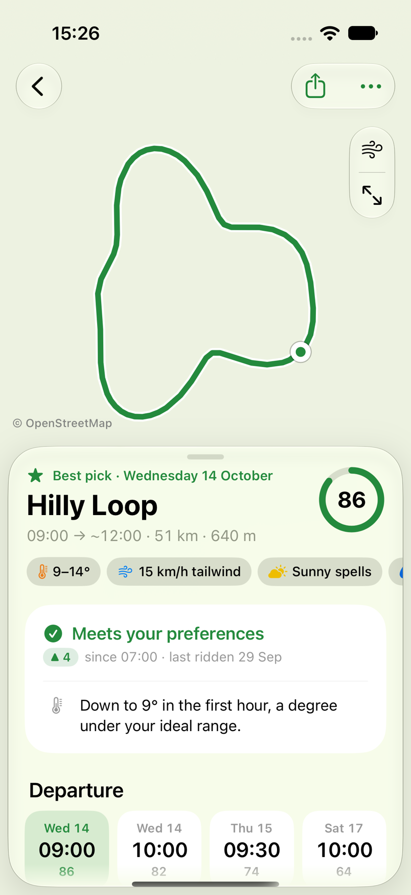 | 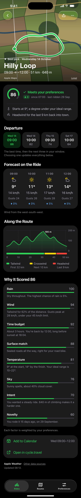 |

1. **Hero**, 400pt, same art and title block as Rides, no commit star in the hero.
2. **Verdict card**: `ScoreGauge` (64pt ring, 86), "✓ Meets your preferences", "▲ 4 since 07:00 ·
   last ridden 29 Sep". Then notes with symbols:
   - 🌡 "Starts at 9°, a degree under your ideal range."
   - 💨 "Headwind for the last 9 km back into town."
3. **"Departure"**: `DeparturePicker`, four tiles: Wed 14 09:00 86 (selected), Wed 14 10:00 82,
   Thu 15 09:30 74, Sat 17 10:00 64. Footnote: "The best time, then the next three in your window.
   Choosing one updates everything below."
4. **"Forecast on the Ride"** card: one column per ride hour.

   | Time | Sky | Temp | Wind | Gusts | Rain |
   |---|---|---|---|---|---|
   | 09:00 | sun behind cloud | 9° | 14 km/h | 24 | 0% |
   | 10:00 | sun | 11° | 15 km/h | 26 | 0% |
   | 11:00 | sun | 13° | 17 km/h | 28 | 5% |
   | 12:00 | sun behind cloud | 14° | 16 km/h | 27 | 5% |

   Footnote: "Wind from the west-south-west.", only when there's no "Wind on the Ride" below.
5. **"Sky on the Ride"** card, the extension's sun chip as a block: multicolour `cloud.sun` and
   "Sun and sunny intervals" (`.headline`; "Part of the ride isn't forecast yet." under it when
   some isn't), a `ShareBar` of sunny / sunny intervals / cloud / not forecast yet in ride order,
   "09:00" and "~12:00" under its ends, then the legend: ● Sunny ~75%, ● Sunny intervals ~25%.
   Summaries follow the extension: "Sunny throughout", "Sunny where forecast", "Sunny intervals",
   "Sun and cloud", "Cloudy", "Overcast", "Fog". No card when nothing is forecast, or when the
   sky is mostly showers or night (the forecast grid already says so).
6. **"Wind on the Ride"** card, the extension's wind panel as a block:
   - `WindRouteMap`: the loop in tailwind green, crosswind orange and headwind red, Start marker.
     Only when the API placed the wind stretches (`windStretches`); ride hours alone don't place
     the wind finely enough to colour the road.
   - "Wind from the south-west" (`.headline`), "Then from the west." under it, a `WindCompass`
     (arrow towards the north-east, "10 mph") trailing. Light all the way: "Light wind", "Under
     10 km/h all the way.", no arrow. Stacks at accessibility sizes.
   - A `ShareBar` of the stretches with compass points where the wind turns ("SW" … "W"), only
     when it does; "09:00" and "~12:00" under its ends.
   - Legend, largest first: ● Tailwind 9 mph ~65%, ● Crosswind 11 mph ~20%, ● Headwind 10 mph
     ~20%. Light wind reads "under 6 mph".
   - Divider, then `wind` "Gusts up to 28 km/h" (semibold) and the extension's sentence: "Mostly
     behind you, so they help. At most 28 km/h against you." Over your comfort or limit the
     symbol turns orange and the sentence says where: "From the side on the way back,
     10:31–11:40. Over your 35 km/h comfort."
7. **"Along the Route"**: `RouteProfile`. Elevation area chart 0–200 m over 0–50 km, peak marker
   "186 m" at ~31 km; under it a wind strip (accent tailwind 0–32 km, yellow crosswind 32–42 km,
   red headwind 42–51 km) and a legend: Tailwind "First 32 km", Crosswind "Next 10 km", Headwind
   "Last 9 km".
8. **"Why It Scored 86"**: one `FactorRow` per factor, name + score + bar + one sentence.

   | Factor | Score | Sentence |
   |---|---|---|
   | Rain | 100 | Dry throughout. The highest chance of rain is 5%. |
   | Wind | 94 | Tailwind for 62% of the distance. Gusts peak at 28 km/h, under your 45 km/h limit. |
   | Time budget | 92 | About 3 hours. You're back by 12:00, long before sunset at 18:04. |
   | Surface match | 88 | Sealed roads all the way, right for your road bike. |
   | Temperature | 81 | 9° at the start, 14° by the finish. Your ideal range is 10–22°. |
   | Sky | 76 | Sunny spells, about 40% cloud cover. |
   | Intent | 70 | You wanted a steady ride. 640 m of climbing makes it a harder one. |
   | Novelty | 60 | You rode it 15 days ago, on 29 September. |

   Footnote: "Each factor is weighted by your preferences."
9. **Actions** card (accent list buttons): "Add to Calendar" (trailing "Wed 09:00–12:00"),
   "Open in cycle.travel".
10. **Footer**: the forecast provider's attribution ("Apple Weather · Other data sources", or the
   provider's own line, such as "Powered by Met Office data"); "Updated 08:12."

Chrome: back (44pt circle, `chevron.left`, label "Rides") leading; one capsule with share and
more (`ellipsis`) trailing. Clear glass over the hero, regular from about 260–320pt of scroll; the
inline title "Hilly Loop" fades in at about 290–330pt.

Build:
- [x] Hero (reuse `RideHero`, 400pt variant). The hero map ignores touches, so Legal shows but
      isn't tappable on either screen
- [x] Toolbar: back + share/more capsule (more holds Add to Calendar and Open in cycle.travel),
      inline title fades in at 290–330pt. Clear → regular glass is left to the system
- [x] Verdict card with `ScoreGauge`
- [x] `DeparturePicker`; selection swaps the forecast, profile wind strip and factors
- [x] Forecast grid (rows instead of columns at accessibility sizes)
- [x] `RouteProfile` (Swift Charts area + wind strip, scrubbing)
- [x] `FactorRow` list
- [x] Add to Calendar (EventKit, write-only access) and Open in cycle.travel
- [x] Zoom destination (iOS only; macOS pushes)
- [x] Light/dark and Dynamic Type through `accessibility5` checked on the simulator
- [ ] Reduce Motion: the zoom should fall back to a cross-fade (system behaviour, not yet checked)
- [x] Sample data: `RideDetail.sample(for:on:)` in `Models/RideDetail.swift`, built from any pick
- [x] Notes and factor sentences measured against your preferences (`resolvedPreferences`), live
- [x] Footer shows the forecast provider's own attribution (`weather.attribution`)
- [x] "Wind from the …" footnote from `windFromDegrees` in 16 compass words, hidden when null or when "Wind on the Ride" shows ([reviewed contract](ride-detail-api-requests.md) §1)
- [x] "Sky on the Ride": the extension's sky chip rules (`extension/ui/format.ts` `skyChip`) over
      `conditions.skyConditionShares` per ride hour and for the ride, `sunshineAssessment` for
      what isn't forecast yet (`RideDetail.SkyBreakdown`)
- [x] "Wind on the Ride": the extension's wind panel (`extension/ui/wind.ts`) over `windStretches`,
      falling back to `rideHours[]` without the map; gusts sentence against your comfort and limit
      in your units and the response time zone (`RideDetail.WindBreakdown`)
- [x] Both checked in light, dark and at accessibility sizes on the simulator
- [x] "▲ 4 since 07:00" badge from `best.previous`, only when the rounded change is at least 1 (§2)
- [x] Additional-factor decision: explain the seven existing factors; keep time feasibility and recent-rides deductions separate, with no invented Surface match or Intent scores (§3)

## 3. Ride Window (sheet)

| Light | Dark |
|---|---|
| 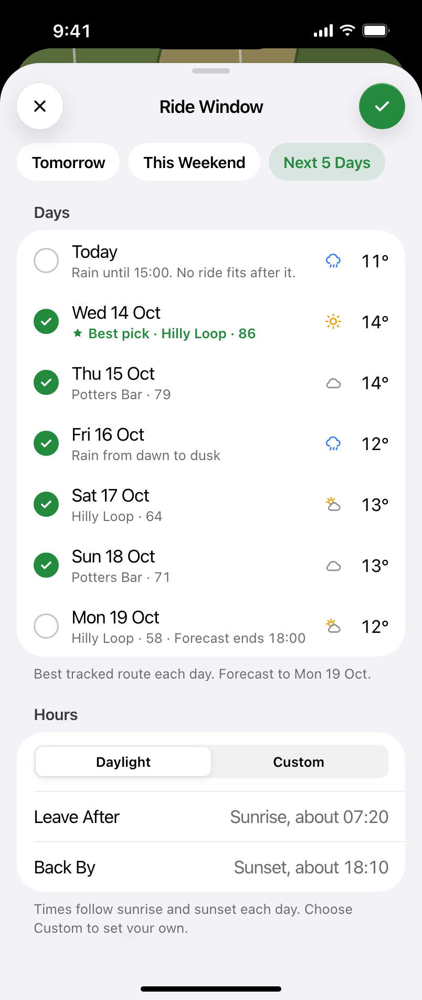 | 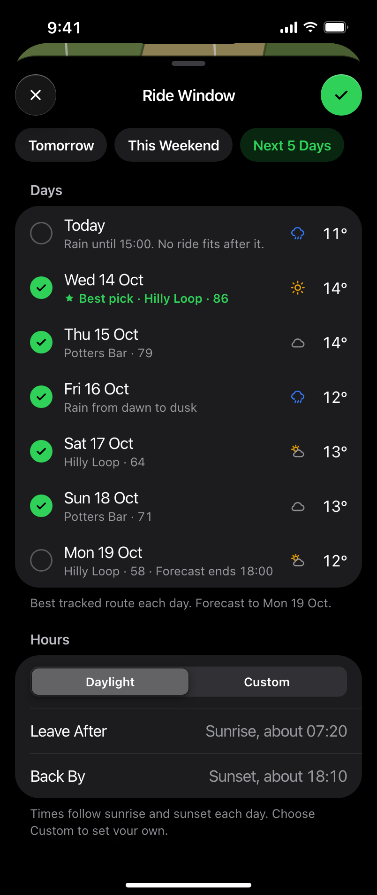 |

Large detent over the Rides screen.

1. Header: grabber; Cancel (glass circle, `xmark`, `role: .cancel`) leading; "Ride Window"
   centred; Done (tinted circle, `checkmark`, `role: .confirm`) trailing.
2. Quick picks: "Tomorrow", "This Weekend", "Next 5 Days" (selected: soft accent fill, accent text).
3. **"Days"**: multi-select list. Leading circle checkmark (accent when on), day, one line, sky
   symbol, temperature.

   | Day | On | Line | Temp |
   |---|---|---|---|
   | Today | | Rain until 15:00. No ride fits after it. | 11° |
   | Wed 14 Oct | ✓ | ★ Best pick · Hilly Loop · 86 (accent) | 14° |
   | Thu 15 Oct | ✓ | Potters Bar · 79 | 14° |
   | Fri 16 Oct | ✓ | Rain from dawn to dusk | 12° |
   | Sat 17 Oct | ✓ | Hilly Loop · 64 | 13° |
   | Sun 18 Oct | ✓ | Potters Bar · 71 | 13° |
   | Mon 19 Oct | | Hilly Loop · 58 · Forecast ends 18:00 | 12° |

   Footnote: "Best tracked route each day. Forecast to Mon 19 Oct."
4. **"Hours"**: segmented Daylight | Custom; "Leave After" "Sunrise, about 07:20"; "Back By"
   "Sunset, about 18:10". Custom swaps the values for `DatePicker(.hourAndMinute)`.

Build:
- [x] Sheet with `.presentationDetents([.large])`, Cancel/Done toolbar (#162)
- [x] Quick picks that select their day range (#162)
- [x] Days list with multi-select (#162)
- [x] Hours section, Daylight/Custom (#162)
- [x] Done applies the window to Rides; Cancel discards (#162; live only, the fixture world's Done
  just closes the sheet)

`RideWindowSheet` (`RideUI/RideWindowSheet.swift`). The days are the board's `forecast` (today
onwards, chosen or not); the ★ Best pick line follows the selection live. A quick pick is
highlighted while the selection is exactly its days. Done is disabled with no days, or when Back
By isn't after Leave After. The "No Rides in Your Window" empty state has a "Choose Dates"
button into the same sheet until Window passed lands.

## 4. Window passed

| Light | Dark |
|---|---|
| 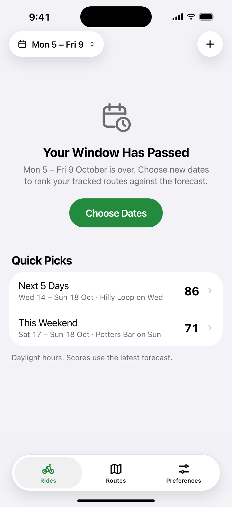 | 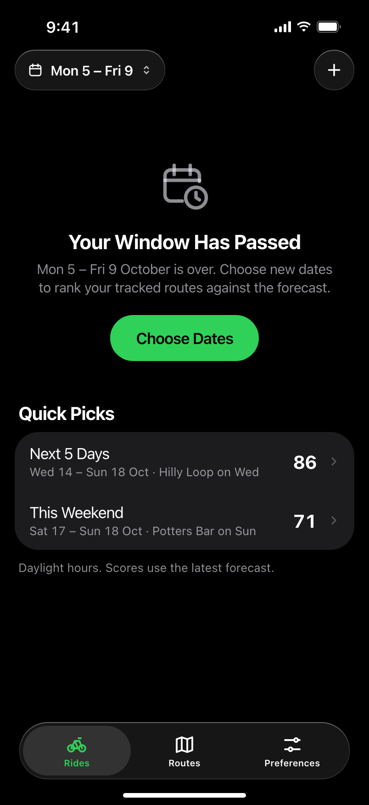 |

Rides when the saved window is in the past. No hero, so the toolbar is regular glass; the
capsule shows the stale range "Mon 5 – Fri 9".

1. `ContentUnavailableView`: `calendar.badge.clock`, "Your Window Has Passed", "Mon 5 – Fri 9
   October is over. Choose new dates to rank your tracked routes against the forecast.", and
   "Choose Dates" (`.borderedProminent`, the screen's one tinted action) opening the sheet.
2. **"Quick Picks"** card rows:
   - "Next 5 Days" · "Wed 14 – Sun 18 Oct · Hilly Loop on Wed" · 86
   - "This Weekend" · "Sat 17 – Sun 18 Oct · Potters Bar on Sun" · 71
   Footnote: "Daylight hours. Scores use the latest forecast."

Build:
- [ ] Empty state + Choose Dates
- [ ] Quick Picks rows apply that window directly

## 5. Preferences (tab)

| Light | Dark |
|---|---|
| 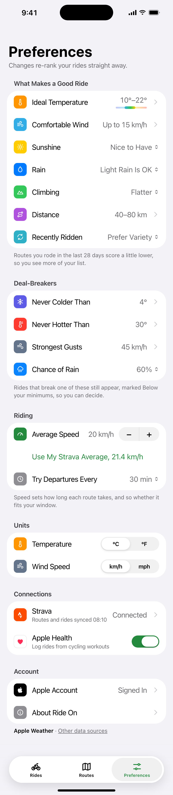 | 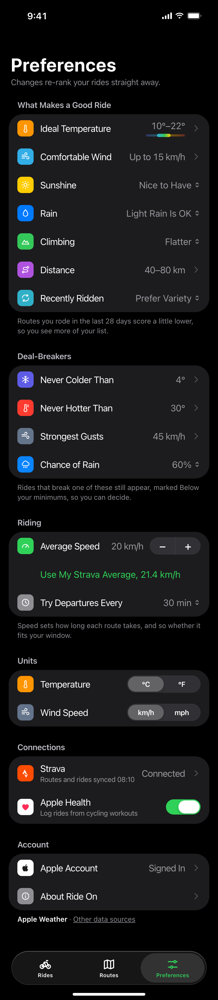 |

`Form` (grouped), large title "Preferences", subtitle "Changes re-rank your rides straight away."
Rows have a 30pt rounded-square coloured icon.

| Section | Rows | Footer |
|---|---|---|
| What Makes a Good Ride | Ideal Temperature "10°–22°" + mini ramp → push · Comfortable Wind "Up to 15 km/h" → push · Sunshine "Nice to Have" (menu) · Rain "Light Rain Is OK" (menu) · Climbing "Flatter" (menu) · Distance "40–80 km" (push) · Recently Ridden "Prefer Variety" (menu) | Routes you rode in the last 28 days score a little lower, so you see more of your list. |
| Deal-Breakers | Never Colder Than 4° ("By Month" for a monthly table) · Never Hotter Than 30° · Gust Limit 45 km/h · Chance of Rain 60% (menu) | Rides that break one of these still appear, marked Below your minimums, so you can decide. |
| Riding | Average Speed 20 km/h + stepper · "Use My Strava Average, 21.4 km/h" (accent button) · Try Departures Every 30 min (menu) | Speed sets how long each route takes, and so whether it fits your window. |
| Units | Temperature °C/°F · Wind Speed km/h/mph · Distance km/mi (segmented, each saved on its own) | |
| Connections | Strava "Connected", subtitle "Routes and rides synced 08:10" (push) · Apple Health switch, subtitle "Log rides from cycling workouts" | |
| Account | Apple Account "Signed In" ("Account" when Apple isn't linked) · About Ride On | Apple Weather · Other data sources |

Icon colours: temperature orange, wind cyan, sunshine yellow, rain blue, climbing green, distance
purple, recently ridden teal, colder indigo, hotter red, gusts grey-blue, chance of rain blue,
speed green, interval grey, Strava orange, Health white with red heart, Apple black, About grey.

Build:
- [x] Form with all sections, menus, stepper, segmented units, Health toggle
- [x] Distance range editor (push)
- [x] Settings model mirroring the API `settings` shape, held in an `@Observable` store
- [x] Strava account connection, disconnect and completed cycling history (backend rollout pending)
- [ ] "Use My Strava Average" and route imports (deferred)
- [x] Account label from `/auth/me` `user.providers` (linked methods, not this session's), and Sign-In Methods on the Account screen

## 6. Ideal Temperature (push)

| Light | Dark |
|---|---|
| 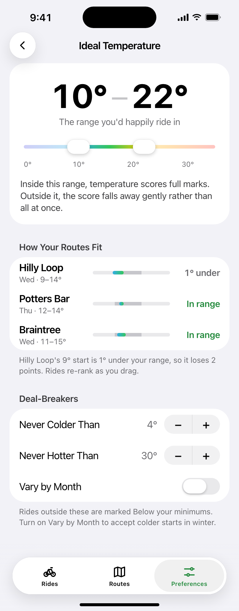 | 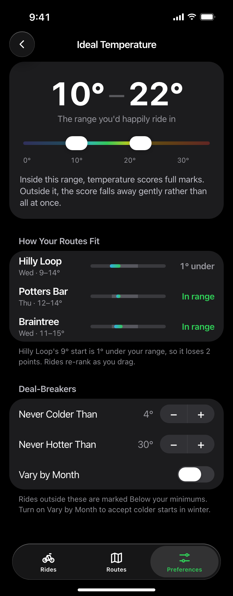 |

1. Card: "10°–22°" (large, bold, monospaced), "The range you'd happily ride in", `TemperatureRange`
   two-handle slider on a 0–35° `ConditionPalette` ramp (faded outside the range), ticks 0° 10° 20°
   30°, then "Inside this range, temperature scores full marks. Outside it, the score falls away
   gently rather than all at once."
2. **"How Your Routes Fit"**: per route, name + "Wed · 9–14°", a mini range bar against the
   preference, and status: Hilly Loop "1° under" (secondary), Potters Bar "In range" (accent),
   Braintree "In range". Footer: "Hilly Loop goes down to 9°, 1° under your range. It could gain
   2 points if the temperature were ideal. Rides re-rank as you drag." The points sentence comes
   from `pointsLost` and shows only while the board was scored with the range on screen.
3. **"Deal-Breakers"**: Never Colder Than 4° (stepper), Never Hotter Than 30° (stepper), Vary by
   Month (switch). With it on, Never Colder Than pushes a 12-month list of the rider's own limits;
   unset months read "Not Set" and use the fallback, or have no limit. Footer: "Rides outside these
   are marked Below your minimums." No automatic seasonal offsets; saved tables are kept.

Inline title "Ideal Temperature", glass back button. Saves as you go; no Done.

Build:
- [x] `TemperatureRange` (drag both handles, 1° steps, selection haptic)
- [x] Route fit rows recompute as you drag
- [x] Deal-breaker steppers
- [x] User-chosen monthly limits, month by month; existing tables and unset months kept ([reviewed contract](preferences-api-requests.md) §6)
- [x] Point-loss wording from `pointsLost` (`Pick.gainSentence`): rounded from 1, "a small effect" below it, nothing at zero or unknown, and nothing once the edited values differ from the board's `resolvedPreferences`

## 7. Comfortable Wind (push)

| Light | Dark |
|---|---|
| 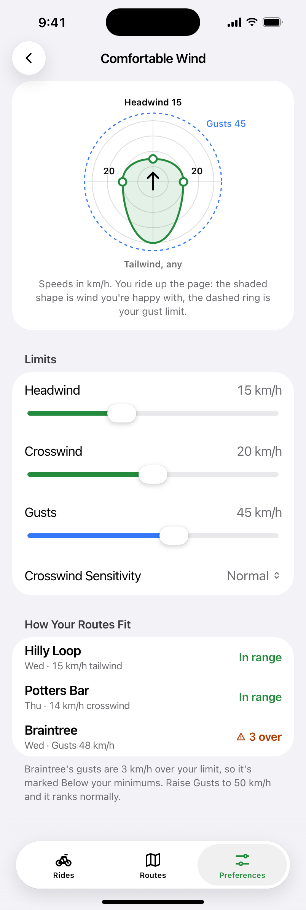 | 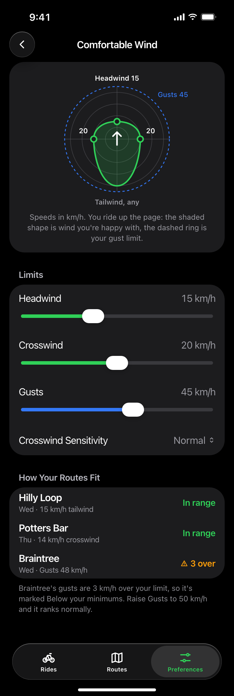 |

1. Card: `WindEnvelope` polar chart. You ride up the page; headwind limit at the top ("Headwind
   15"), crosswind limits left and right ("20"), "Tailwind, any" at the bottom; accent shaded
   shape is the comfortable envelope; dashed blue ring is the gust limit ("Gusts 45"). Caption:
   "Speeds in km/h. You ride up the page: the shaded shape is wind you're happy with, the dashed
   ring is your maximum gust limit."
2. **"Limits"**: Headwind 15 km/h, Crosswind 20 km/h (accent sliders), Gust Limit 45 km/h (blue
   slider, "No Limit" at the top), Crosswind Sensitivity "Normal" (menu). Footer: "Wind over your
   headwind or crosswind comfort scores lower. Gusts over the limit mark a ride Below your minimums."
3. **"How Your Routes Fit"**: Hilly Loop "Wed · 15 km/h tailwind" In range; Potters Bar "Thu ·
   14 km/h crosswind" In range; Braintree "Wed · Gusts 48 km/h" "⚠ 3 over" (warn). Footer:
   "Braintree's gusts are 3 km/h over your limit, so it's marked Below your minimums. Raise the
   gust limit to 50 km/h and it ranks normally."

Build:
- [x] `WindEnvelope` (Canvas/Path), redraws live from the sliders
- [x] Limits sliders + sensitivity menu
- [x] Crosswind Sensitivity saves `preferenceLevels.crosswind`; `custom` shows read-only until the rider picks a level; hidden on APIs older than v0.25.0
- [x] The slider is the hard maximum (`minimumStandards.maximumGustKph`), labelled Gust Limit; gust comfort stays untouched ([reviewed contract](preferences-api-requests.md) §3)
- [x] Route fit rows

## 8. Widgets and Lock Screen

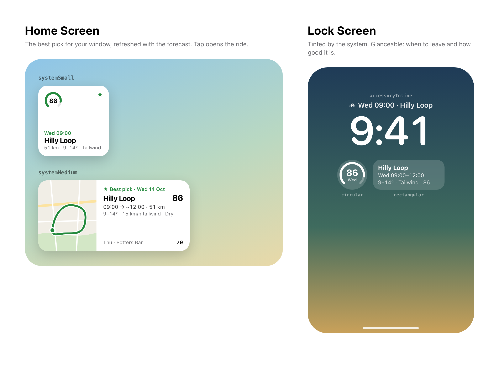

- `systemSmall`: `ScoreGauge` 86, "★ Wed 09:00", "Hilly Loop", "51 km · 9–14° · Tailwind".
- `systemMedium`: map thumbnail, "★ Best pick · Wed 14 Oct", "Hilly Loop" 86,
  "09:00 → ~12:00 · 51 km", "9–14° · 15 km/h tailwind · Dry", runner-up "Thu · Potters Bar 79".
- `accessoryInline`: "Wed 09:00 · Hilly Loop".
- `accessoryCircular`: gauge 86 with "Wed".
- `accessoryRectangular`: "Hilly Loop" / "Wed 09:00–12:00" / "9–14° · Tailwind · 86".
- Tap opens that ride's detail.

Build:
- [ ] Widget extension target + timeline from the same `RideBoard` data
- [ ] All five families

## 9. Routes (tab)

| Library, medium | History, large |
|---|---|
| 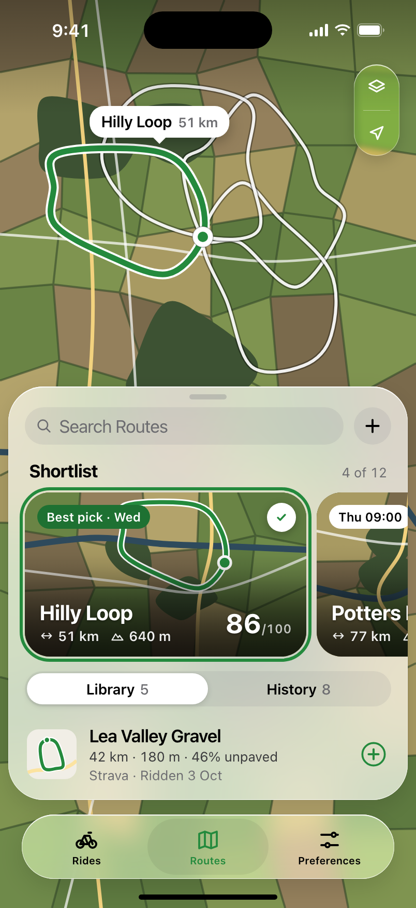 | 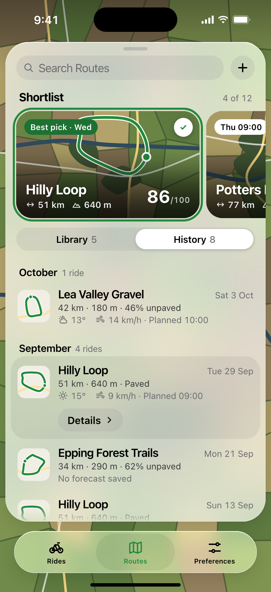 |

A full-screen satellite map with a regular-glass panel floating over it, 8pt from the screen
edges and 14pt above the tab bar. No navigation bar, and the tab bar never minimises here.

1. **Map** (`RoutesMap`): the other shortlisted routes in white, the selected one in the accent
   with a white casing and a start marker, and a callout over its northernmost point ("Hilly
   Loop 51 km"; from History, the ride's date: "Hilly Loop 29 Sep"). Tapping near a line selects
   it. Top trailing: clear-glass Map Style menu (Satellite, Hybrid, Standard) and My Location.
2. **Panel** (`FloatingPanel`): medium detent 56% of the height, large up to the safe-area top.
   Drag the header (1:1, rubber-banded, momentum picks the detent), tap the grabber, or pull the
   content down at large to go back to medium. Focusing search goes to large.
3. **Header**, pinned: "Search Routes" capsule (filters the shortlist, library and history by
   name or source) and a "+" menu: Import GPX File · From cycle.travel ("Use the Safari
   extension") · Connect Strava ("Coming soon", disabled).
4. **"Shortlist"**, "4 of 12": `ShortlistCard`s, 272 × 158, snapping to the leading edge. Hilly
   Loop "Best pick · Wed" 86, Potters Bar "Thu 09:00" 79, Braintree "Below your minimums" 61,
   East Anglia "Too long for your window". The white check removes a card; tapping one shows it
   on the map.
5. Segmented **Library 5 | History 8**.
6. **Library**: the saved routes not on the shortlist (Lea Valley Gravel, Chilterns Classic,
   Epping Forest Trails, Box Hill Reps, Ware and Hertford): thumbnail, name, "42 km · 180 m ·
   46% unpaved", "Strava · Ridden 3 Oct", and a "+" to shortlist it (disabled when full).
7. **History**: rides grouped by month ("October 1 ride"), each with the day ("Sat 3 Oct"), stats,
   and the forecast saved when it was planned ("⛅ 13° · 14 km/h · Planned 10:00", or "No
   forecast saved"). Footnote: "Weather is the forecast from when you planned each ride, not what
   you rode in."
8. Selecting a row fills it and shows its actions: "Add to Shortlist" (library routes not on the
   shortlist) and "Details ›" (routes Rides has ranked) pushing Ride detail.

iPad and Mac: the same map, with the panel as a fixed 380pt column down the leading edge.

Build:
- [x] Full-screen map with route lines, start marker, callout and map controls
- [x] Floating panel with medium/large detents, velocity-carrying settle, pull-down to collapse
- [x] Search, "+" menu (items are no-ops for now)
- [x] Shortlist carousel with status pills, scores, remove
- [x] Library and History segments, row selection and actions, Details → Ride detail
- [x] Accessibility sizes (cards widen and stack, rows wrap), Reduce Transparency/Increase Contrast fallbacks
- [x] Wire to the API (below)

**Open points.**
- Loads on every visit to the tab (`LiveRoutesView`, `RouteLibraryLoader`): `GET /route-selection`
  (the shortlist; the cap of 12 is the API's), every page of `GET /routes?limit=100` (library),
  `GET /rides?limit=100` (History: the newest 100 rides only, for now), `POST /rides/summaries`
  ("Ridden 3 Oct") and `GET /routes/:id/geometry` for routes whose geometry is `available`, six
  at a time and kept per route version. A failed reload keeps what's showing. Signed out says to
  sign in on the Rides tab; the fixture world keeps `RouteLibrary.sample`.
- Shortlist edits save at once with `PUT /route-selection {expectedVersion, routeIds}`. A 409
  re-reads the list and replays this device's additions and removals onto it; edits made while a
  save is in flight go out next. Any other failure puts the shortlist back as the API had it,
  with "Couldn't Save Your Shortlist". After a save the Rides board reloads, so the cards' status
  pills follow; until then a new card shows "Checking the forecast…".
- The status pills and Details come from the last board Rides loaded; Routes fetches one if Rides
  hasn't loaded yet.
- A History ride shows the route as ridden (the name, distance and climb saved with the ride),
  drawn with the saved route's path; a deleted route's ride stays, with no line. A plan the app
  can't read shows "No forecast saved". Temperature is the middle of the plan's range.
- An empty library says "Routes you import with the Ride On extension on cycle.travel appear here."
- Details only shows for routes Rides has ranked (it opens `RideDetailView` for that pick).
- The "+" items do nothing yet. The cycle.travel import comes back later as a Dynamic Island
  (Live Activity) flow rather than a panel section.
- The panel can't be grabbed mid-settle; a new drag starts from the detent.
- The map uses flat `.imagery`/`.hybrid`/`.standard`; `elevation: .realistic` dropped the
  annotations and blurred the lines.

## Design language board

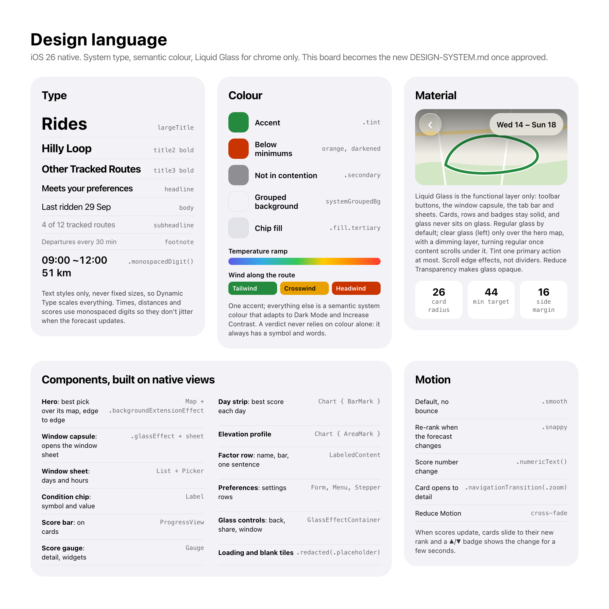

---

## Sample data

Every screen above renders from one value, `RideBoard.sample`, so previews, UI tests
(`--fixture-world`) and the canvas agree. "Today" in the sample is Tuesday 13 October 2026;
the window is Wed 14 – Sun 18 October, daylight hours.

| Route | Distance | Climb | Best | Window score |
|---|---|---|---|---|
| Hilly Loop | 51 km | 640 m | Wed 09:00 → ~12:00 | 86 (Sat 64, Mon 58) |
| Potters Bar | 77 km | 410 m | Thu 09:00 → ~13:20 | 79 (Sun 71) |
| Braintree | 51 km | 280 m | Wed 09:30 → ~12:30 | 61, below minimums (gusts 48 > 45) |
| East Anglia | 112 km | — | doesn't fit (7h 05m vs 5h 45m) | — |

Preferences in the sample: ideal 10–22°, headwind 15, crosswind 20, gusts 45 km/h, never colder
than 4°, never hotter than 30°, rain chance limit 60%, 20 km/h, departures every 30 min, distance
40–80 km, °C and km/h.

## Wiring notes

The Rides tab is live outside the fixture world (`LiveRidesView`, which falls back to
`RidesView(board: .sample)` under `--fixture-world` so E2E never touches the network).
`RideBoardLoader` (`Services/RideBoardLoader.swift`) builds the board; `RideOnAPI` holds the
session.

**Sign-in.** Apple or Google through the PKCE browser handoff
([`docs/authentication.md`](../authentication.md), "iOS and macOS app"):
`POST /auth/browser/start` → `ASWebAuthenticationSession` with an `https` callback on
`api.ride-on.cc/auth/browser/done` → `POST /auth/browser/exchange`. The session token lives in the
keychain; a refreshed `set-auth-token` replaces it; a 401 signs out. The `https` callback needs the
`webcredentials:api.ride-on.cc` associated domain, in both the iOS and macOS entitlements.

**Loading.** `GET /route-selection` (the extension's shortlist) → `GET /users/me` (saved
planning days and window; presets resolved to dates the way the extension does, so "Next 5 Days"
starts tomorrow) → in parallel `POST /recommendations {routeIds, days, previewDays: 7, riding:
{window}}`, `POST /rides/summaries`,
and per route `GET /routes/:id` (cycle.travel link) and `GET /routes/:id/geometry` (polyline6 for
the map). Ride detail's elevation profile samples the geometry through Open-Meteo on first open.

| UI | API |
|---|---|
| Picks (hero, other routes) | `rankings[].best`, ordered as ranked |
| Score | `best.score`, rounded |
| Meets your preferences / Below your minimums | `best.standards.status` |
| Temperature, wind, sky chips | `best.conditions` (dominant wind and sky by distance fraction) |
| Last ridden | `POST /rides/summaries` `lastRiddenOn` |
| Your Window days | `days[]` where `selected`, each day's `best` |
| Ride Window days | every `days[]` entry (`previewDays: 7`): `best`, `temperatureMaxC`, `until` (Forecast ends), `availabilityReason` (the grey line), `daylight` (Sunrise/Sunset) |
| Ride Window Done | `PATCH /users/me {expectedVersion, settings: {planning: {days, window}}}` (a quick pick saves as its preset, anything else as dates), then the board reloads with that window |
| Window range | `range.dates` in the response `timeZone` |
| Doesn't Fit Your Window | `unranked` with `no_feasible_departure` |
| Departure tiles | `best` + up to three `alternatives` |
| Forecast on the Ride | `rideHours[]` |
| Wind strip | `rideHours[]` dominant wind, merged into stretches |
| Sky on the Ride | `rideHours[].conditions.skyConditionShares` (or `skyConditionDistanceFractions`), `best.conditions` for the ride, `sunshineAssessment` |
| Wind on the Ride | `windStretches[]` (map, bar, legend, gusts placement), else `rideHours[]`; `best.conditions` gusts; `resolvedPreferences` gust comfort and limit |
| Why It Scored | `factors`, sorted by score |
| Notes | Built in the app from `best.conditions`, `rideHours[]`, `recentRides` and `distanceFit`, measured against `resolvedPreferences`; `drawbacks` only when preferences are missing |
| Factor sentences | `factors` + `conditions`; Wind and Temperature quote your limits from `resolvedPreferences` |
| Footer | `weather.attribution` (Apple Weather when empty) |
| Preferences, Ideal Temperature, Comfortable Wind | `GET /users/me` → `settings.riding`, `settings.preferences`, `settings.units`, `settings.display`, `preferenceLevels`, and `GET /auth/me` → `user.providers`; each edit sends `PATCH /users/me {expectedVersion, settings}` after 0.6 s (explicit `null` removes a limit or the distance range; a 409 re-reads and re-sends), then Rides reloads |
| How Your Routes Fit | The last board Rides loaded, measured against the edited values in the app |

**Not wired yet.** Unassessable routes aren't shown; a conflicting settings edit (409) keeps
the old saved window, though that load still uses the new one; dates assume the device and the
routes share a time zone; "Track a route" is still a no-op. Strava connection/history needs
the [coordinated rollout](../strava.md); route imports and speed suggestions remain deferred. Crosswind
Sensitivity stays hidden until the API returns a level (v0.25.0). "How Your Routes Fit" is empty
until Rides has loaded once. The Rides day strip doesn't show the sheet's "Rain until 15:00"
style notes yet.
